# STUDENTBENCH BUILD INSTRUCTIONS
This build routine will provide a nearly identical environment to the one found installed on ARKOV's Jetson.

Following this guide on your desired machine (Student Bench in this example) will allow testing compilation on ARKOV's Jetson hardware remotely. Useful for when off-campus or access to the lab is unavailable.

*Note:* While this guide will attempt to remain general, it is based on Student Bench and will thus be a linux (`bash`) oriented guide. macOS (`zsh`) users should find the provided commands compatible; Windows (`Powershell`) users may either adapt commands as needed or install Windows Subsystem for Linux (WSL) and follow as normal.

**Contents**

 - [Prerequisites](#prerequisites)

 - [Download and Install](#download-and-install)

 - [Using SDK Manager](#using-sdk-manager)

 - [Setting Up The Build Environment](#setting-up-the-build-environment)

 - [Launch The Container](#launch-the-container)

 - WIP

     - \[TODO] Fix broken Dockerfile. Currently is not pulling Nvidia library files. Only impacts [objectDetection](../objectDetection/) at the moment, other parts of the repository may or may not build.

     - Since the Dockerfile is broken, I probably would not recommend following the guide in its current state, as I imagine it would be a huge headache to update the development environment. A completed version of the guide will be announced.

# Prerequisites
Install the following programs based on your platform:

 - Docker

 - VSCode (optional)

 - WSL (optional)

# Download and Install

We'll begin by downloading the [NVIDIA SDK Manager](https://developer.download.nvidia.com/sdkmanager/redirects/sdkmanager-docker-image-ubuntu2004.html) docker image. Save this file into the `docker` directory within the repository.

Open a terminal in the `docker` directory

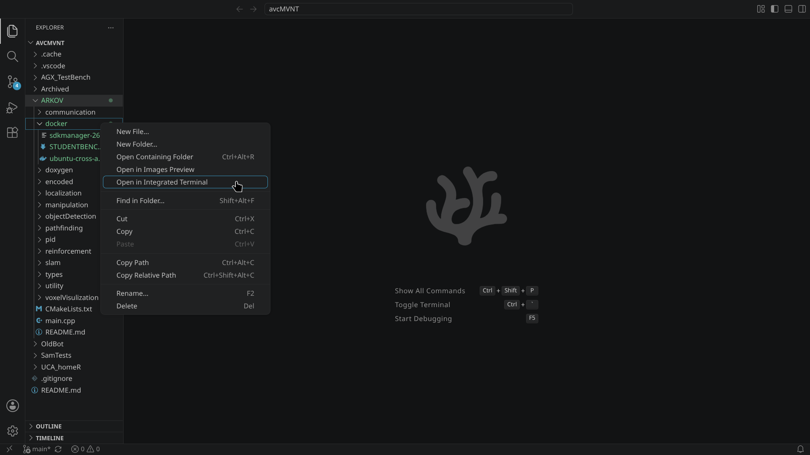

 - Load the docker image

*bash*

```
docker load -i ./sdkmanager-26.1.0.14392-Ubuntu_20.04_docker.tar.gz
```

 - Tag the image for convenience

*bash*

```
docker tag sdkmanager:26.1.0.14392-Ubuntu_20.04 sdkmanager:latest
```

 - Ensure that everything is setup correctly

*bash*
```
docker images
```

The output of the above command should show something similar to the output below.

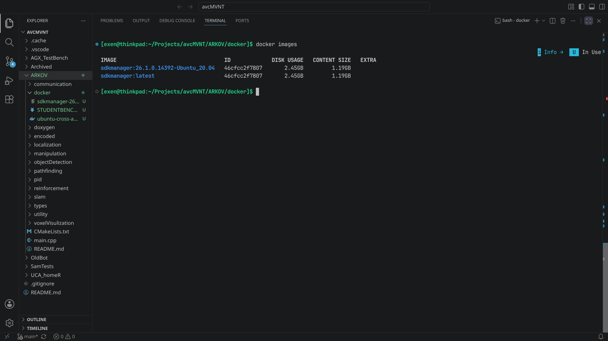

# Using SDK Manager
This section will give us dependency packages to use when we create our development environment.

Open two terminal windows. This guide uses split terminals, but any setup that achieves two separate terminal windows is fine.

 - The `Ctrl-Shift-5` keybind will bring up a split terminal

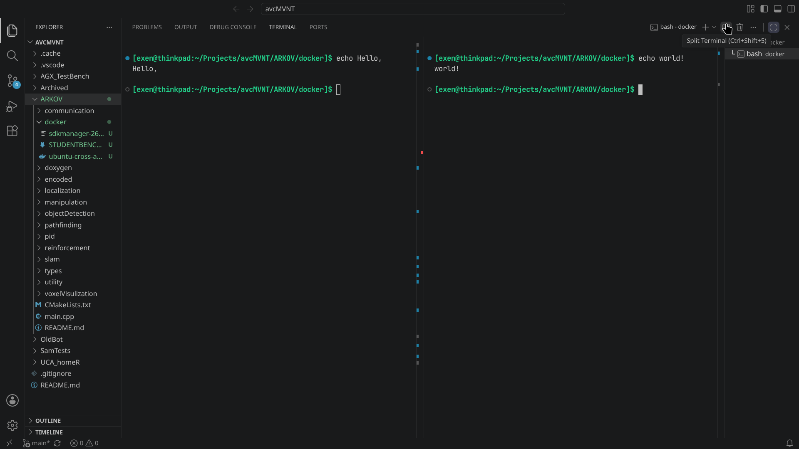

**Downloading the SDK**

Let's begin the download process!

 - In one terminal window, paste the following command.

*bash*
```
docker run -it --rm sdkmanager --cli --action downloadonly --login-type devzone --product Jetson --target-os Linux --version 5.1.5 --show-all-versions --host --target JETSON_AGX_ORIN_TARGETS --additional-sdk 'DeepStream 6.3' --select 'Jetson Linux' --select 'Jetson Runtime Components' --select 'Jetson SDK Components' --license accept
```

*Note:* A quick login into an NVIDIA Developer account is required before download starts. Scrolling up will reveal a link to login if the QR code is too unwieldy to view properly (as in my case!).

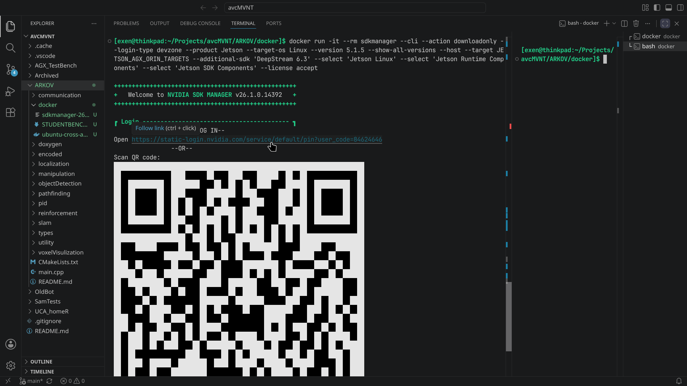

From this point, you should see multiple download bars and a matching terminal log.

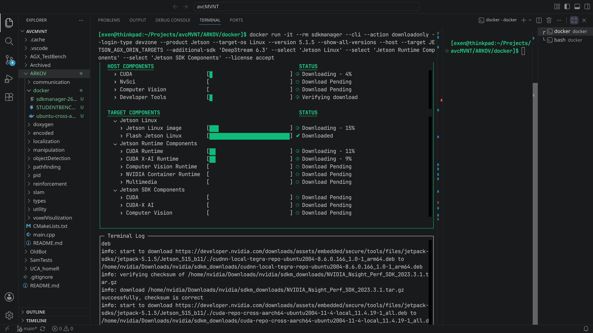

*Note:* Once the download is complete, **don't** close the SDK Manager. It will prompt to press `Enter` to exit, simply ignore this and move to the other terminal window to continue.

 - Ensure the name of the created container

*bash*
```
docker ps
```

 The output of the above command should show something similar to the output below, note the `NAMES` section of the docker container. In this example, the randomly generated name is `recursing_montalcini`

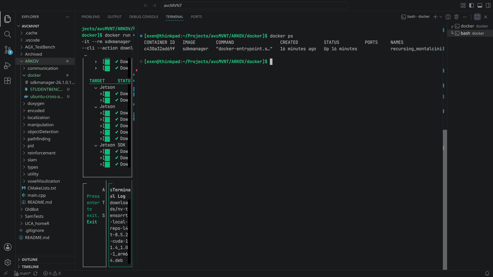

 - We'll quickly enter the container to ensure everything is in order

```
docker exec -it recursing_montalcini /bin/bash

ls Downloads/nvidia/sdkm_downloads/
```

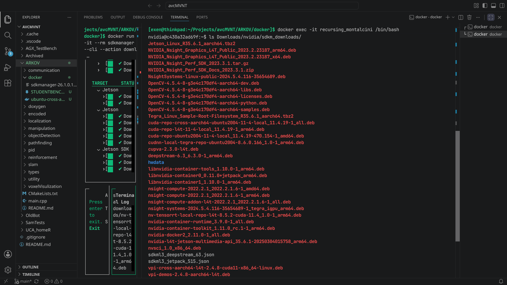

Great, we can see that tons of packages were installed into the container. Let's move them out and into the `docker` directory we've been sitting pretty in!

*Note:* Make sure to `exit` the container before we begin copying

 - Copy files into a new folder named `jetpack_files` within `docker`.

*Note:* NVIDIA requires the new folder be named `jetpack_files`. This filename is hard-coded into the provided Dockerfile.

*bash*
```
docker cp recursing_montalcini:/home/nvidia/Downloads/nvidia/sdkm_downloads/ ~/Projects/avcMVNT/ARKOV/docker/jetpack_files
```

*Note:* Make sure the portion of the above command, `~/Projects/avcMVNT/ARKOV/docker/jetpack_files`, corresponds to the path where you cloned the ARKOV repo!

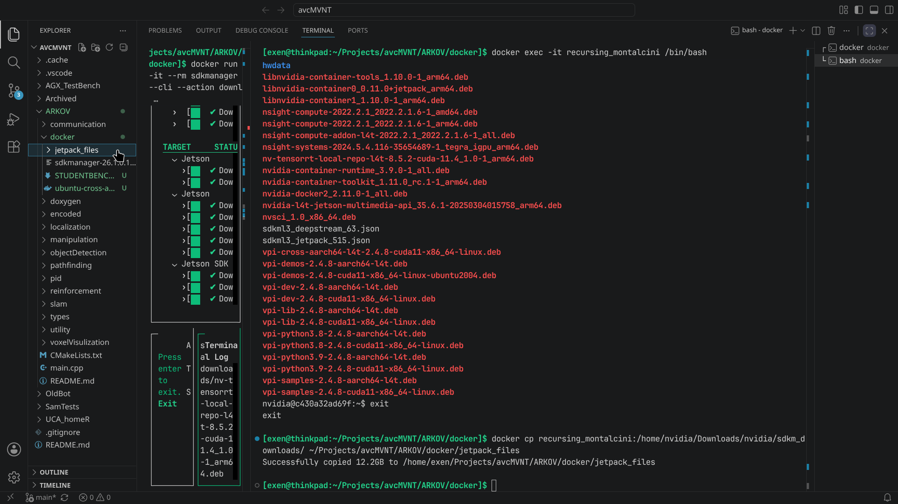

*Note:* Make sure the `jetpack_files` directory pops up in the `docker` directory

 At this point, we should be finished dealing with the SDK Manager! Feel free to close any terminal windows relating to it.

# Setting Up The Build Environment
At this point, we've been working strictly in the `docker` directory. We'll move out of this directory and into the root of the ARKOV repo to continue, as the provided Dockerfile by Nvidia hard-coded this as the build point.

 - Move to the root of the ARKOV repo

*bash*
```
cd ..
```

 - We'll now generate the build container

*bash*
```
./docker/build.sh --file docker/ubuntu-cross-aarch64.Dockerfile --tag arkov-jetpack-cuda11.4
```

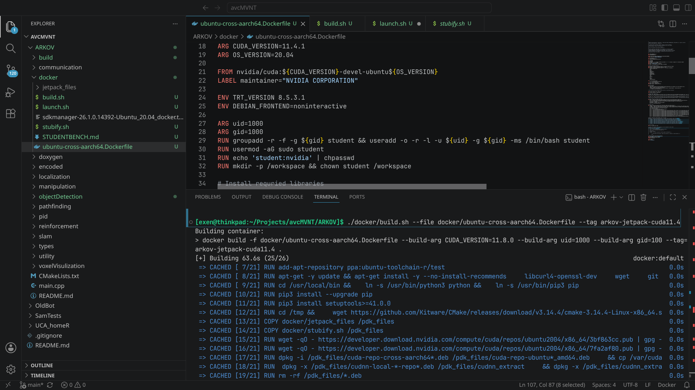

 - Ensure that everything is built correctly

*bash*
```
docker images
```

The image `arkov-jetpack-cuda11.4:latest` should've been added to your images list

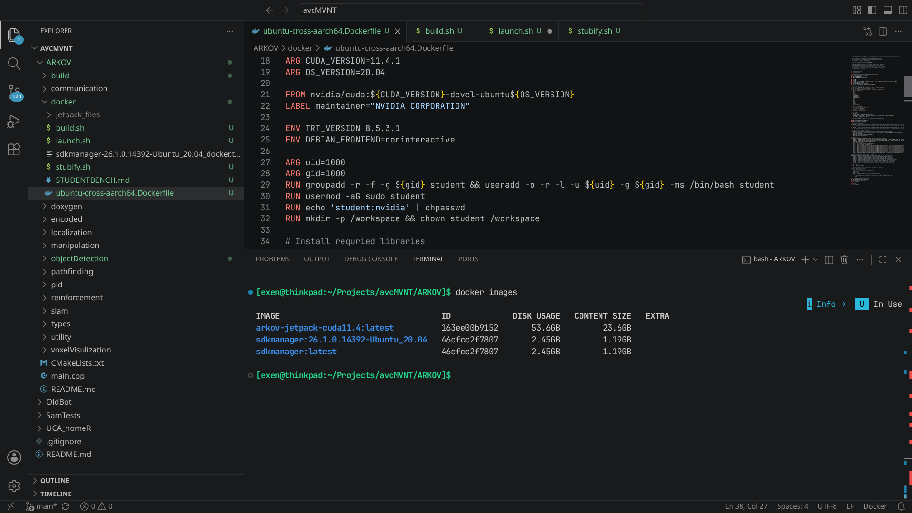

 - Tag the arkov image for convenience

*bash*
```
docker tag arkov-jetpack-cuda11.4:latest arkov:latest
```

At this point, the image for our development environment has been built!
# Launch The Container

 - We can now enter our development environment

*Note:* Depending on your hardware configuration, you may need to modify the `--gpus` tag. If you have a dedicated gpu, set this to `all`, otherwise set this to `none`. We'll use `none` for the sake of the example.

*bash*
```
./docker/launch.sh --tag arkov --gpus none
```

 - Determine the name of your workspace directory, then ensure the expected files (ARKOV repository files) are present

*bash*
```
ls

cd TensorRT/

ls
```

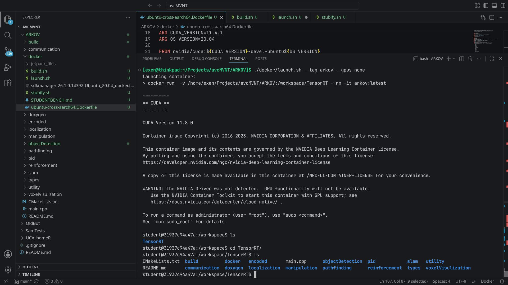

 - WIP

 - \[TODO] Fix broken Dockerfile.

